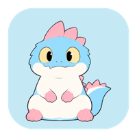
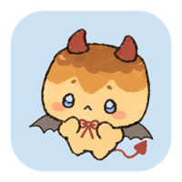
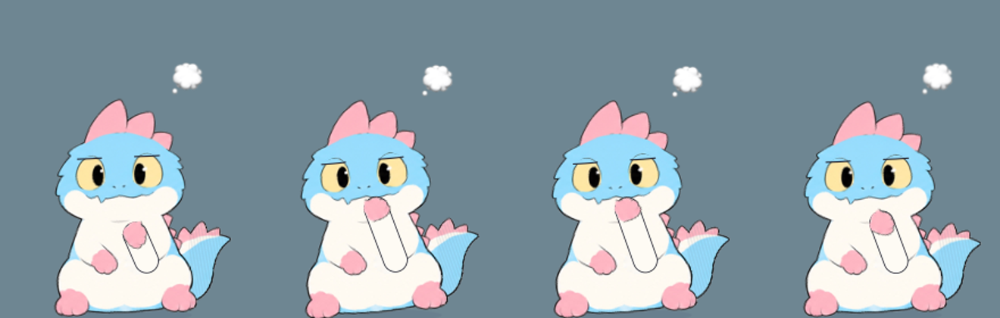

# IP 桌面宠物 · 墩墩 / 蕾蕾 / 布布 / 啵叽 / 噜噜

五只住在 Mac 桌面上的小宠物，每只是一个独立的小软件，想养哪只装哪只。

| 墩墩 | 蕾蕾 | 布布 | 啵叽 | 噜噜 |
|:---:|:---:|:---:|:---:|:---:|
|  |  |  |  |  |
| 龙喵墩墩 | 蕾蕾和布布 | 蕾蕾和布布 | 啵叽和噜噜 | 啵叽和噜噜 |

## 下载安装

到 [Releases](https://github.com/noya21th/ip-desktop-pets/releases/latest) 下载对应角色的 `.dmg`，双击打开，把图标拖进「应用程序」。

第一次打开请**右键 → 打开**（个人做的小软件，没有向苹果交认证费，苹果会多问一句）。详细步骤见每个安装包里的「先看这里-安装说明」。

要求：macOS 13 或更新，苹果芯片和 Intel 的 Mac 都能用。

## 能做什么

- **跟着你**：眼睛一直看着鼠标；鼠标离远了会侧过身来看你。
- **陪你打字**：你一打字，它就站到两颗键帽上，正脸对着你，左右脚轮流踩（像小猫踩奶）；你停下来，它也会若有所思一会儿，墩墩有时还会托着下巴想。
- **摸摸和互动**：鼠标在它身上蹭一蹭会眯眼冒爱心；连点它会生气。拖动、点一下、双击走一走。
- **几十个小动作**：吃饼干、玩球、抱玩偶、盖小被子、吹泡泡、抓蝴蝶、跳舞、打滚、戴耳机听歌……右键菜单里随便点。
- **会睡觉、会提醒**：电脑久不操作它自己睡着；整点和久坐会提醒你起来动一动。
- **搭档互动**：蕾蕾↔布布、啵叽↔噜噜同时开着时，可以一起打招呼、跳舞、听歌、抱抱。
- **墩墩会说话**：每个动作都有一句奶声奶气的台词。

## 关注我们

右键点宠物 →「去账号看看」也能直接打开。

| 账号 | 抖音 | 小红书 |
|---|---|---|
| 龙喵墩墩 | [抖音主页](https://www.douyin.com/user/MS4wLjABAAAAzkNfGj5EERjIAyi9ln4VBFE2HnWu63wPqPcMctMyLlw) | [小红书主页](https://www.xiaohongshu.com/user/profile/6513a79f0000000024017443) |
| 蕾蕾和布布 | [抖音主页](https://www.douyin.com/user/MS4wLjABAAAAtslcXhOA3ZMaffZzDmRIup_NJaGXAIVYUJ44WnbM4wCZ6AobWuz1BtxeYAkmEC70) | [小红书主页](https://www.xiaohongshu.com/user/profile/6357ad53000000001901c1ac) |
| 啵叽和噜噜 | [抖音主页](https://www.douyin.com/user/MS4wLjABAAAAyzvKQwEDmCHJ-1cYjdeXHKkB2XzhFYAWq7IVtzIZyw01ErR3OFzrxDiSxtl7mM-Q) | [小红书主页](https://www.xiaohongshu.com/user/profile/64be473f000000001403eeb7) |

## 版权

墩墩、蕾蕾、布布、啵叽、噜噜的角色形象、美术和声音版权归各自 IP 所有，仅供个人免费使用，未经许可不得商用或二次分发。
